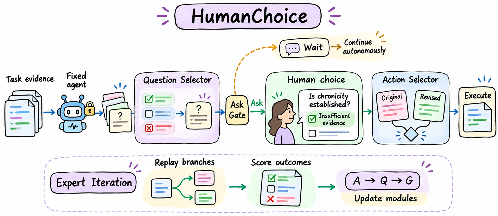

<h1 align="center">HumanChoice</h1>

  <strong>Learning When and What to Ask through Outcome-Grounded Expert Iteration</strong>

  
  

  

> A local answer can change the next decision. HumanChoice learns when that answer is worth asking for, while the agent stays responsible for the task.

## At a glance

| Component | Role |
| --- | --- |
| **Question Selector · Q** | Ranks candidate questions by the outcomes they produce. |
| **Ask Gate · G** | Compares asking now with acting and retaining the option to ask later. |
| **Action Selector · A** | Chooses between the original action and a revision informed by the reply. |

A fixed language model generates candidate questions and actions. During **Expert Iteration**, the system replays alternative branches, scores their completed outcomes, and updates **A → Q → G**. At inference, the agent asks only when the gate selects Ask.

## Quick start

From the repository root:

~~~bash
python -m venv .venv
source .venv/bin/activate
python -m pip install -r requirements.txt
python scripts/check_results.py
~~~

The [reproduction guide](docs/reproduction.md) lists the experiment entry points. The [results archive](experiments/results/) contains the aggregate outputs.

## Citation

~~~bibtex
@misc{humanchoice,
  title = {HumanChoice: Learning When and What to Ask through Outcome-Grounded Expert Iteration},
  note  = {Research code and experiment artifacts}
}
~~~
