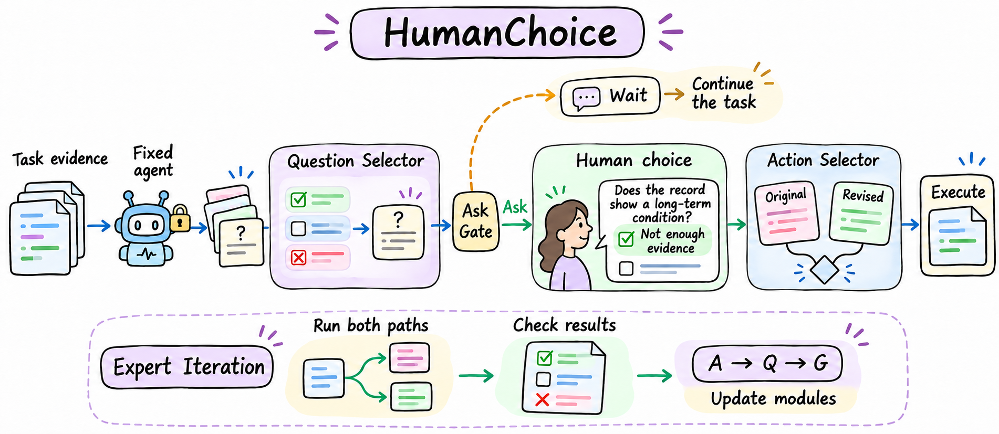

<h1 align="center">HumanChoice</h1>

  <strong>Learning when to ask, what to ask, and how to use the answer</strong>

  
  

  

HumanChoice lets an agent ask for help with a specific decision while it continues to handle the rest of the task. It learns which question to ask, when to ask it, and how to use the answer.

## How it works

| Module | What it decides |
| --- | --- |
| **Question Selector · Q** | Which question is most likely to help the agent complete the task. |
| **Ask Gate · G** | Whether to ask now or continue and keep the chance to ask later. |
| **Action Selector · A** | Whether to use the original action or a revised action based on the answer. |

A fixed language model writes the questions and proposes the actions. The agent keeps its original action available, so a person's answer does not automatically replace it.

During **Expert Iteration**, the training process runs alternative choices and checks the final results. A learns which action works better. Q learns which question helps under A's current choices. G then learns whether asking that question now is better than waiting. The updated agent runs more training tasks to collect new examples.

## Quick start

Run these commands from the project folder. They install the dependencies and check the saved result files without calling a model.

~~~bash
python -m venv .venv
source .venv/bin/activate
python -m pip install -r requirements.txt
python scripts/check_results.py
~~~

See [how to run the experiments](docs/reproduction.md) for the available scripts and data setup. The [saved results](experiments/results/) contain summary scores from the recorded runs.

## Citation

~~~bibtex
@misc{humanchoice,
  title = {HumanChoice: Learning When and What to Ask through Outcome-Grounded Expert Iteration},
  note  = {Research code and saved experiment results}
}
~~~
